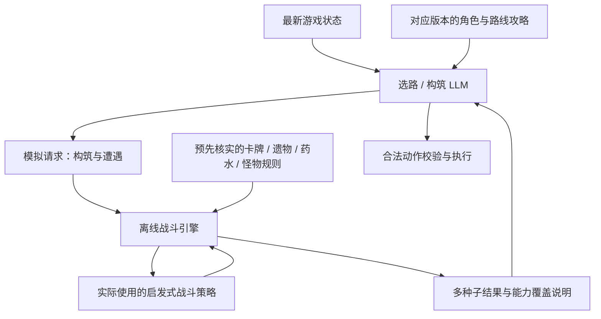

# 架构

本文供开发者和接手的 agent 使用，明确决策分工、模拟器用途及实施边界。当前目标仍是铁甲战士从 A0 逐级打到 A10；实施顺序见 [TODO](TODO.md)。

## 已确定的方案（2026-11-12）

游戏决策分为战斗、选路和构筑。战斗全程使用启发式算法；选路和构筑由 LLM 结合攻略与模拟结果决策。

| 部分 | 决策方式 | 职责 |
|---|---|---|
| 战斗 | 启发式算法，零 LLM | 出牌、目标、药水使用、战斗内弃牌和消耗、结束回合 |
| 选路 | LLM + 当前版本攻略 + 模拟器 | 根据当前构筑、资源、可见路线和候选遭遇，比较风险与成长机会 |
| 构筑 | 按角色定制的 LLM 策略 + 模拟器 | 奖励选牌、药水取舍、事件、商店购买与删牌、遗物选择、篝火休息与升级 |

药水领取与替换属于构筑，使用时机属于战斗；永久删牌和升级属于构筑，战斗内临时选牌属于战斗。现有 `SelectAgent` 可以继续作为选牌界面的执行入口，策略归属按选择目的区分，不必新增顶层 agent。

角色定制先采用同一 LLM 配不同角色的攻略与提示词，从铁甲战士开始。攻略需要标明适用游戏版本、依据和待核实部分，不能把一代知识直接当作二代规则。构筑根据实际组件逐渐收敛，不在开局强制锁定流派。

选路与构筑共享当前局的构筑判断：已有组件、主要短板、下一步需求。每次决策仍以最新游戏状态为准；计划不能覆盖已经变化的卡组、金币和血量。

### 当前实施顺序与 LLM 接入

先完成选路和构筑 LLM 接入，再实现可信模拟器与工具调用。当前通过 `strategy/` 统一角色提示、完整局面和候选选择；铁甲战士已使用基础构筑原则，其他角色暂用通用提示，经过当前版本核实的攻略仍待整理。

模型接收 `situation / task / candidates`，返回 `choice / reason / build_plan`；程序只接受候选中的整数编号，将其映射回已有动作，并执行动作校验。卡牌奖励、商店、事件、药水、遗物、篝火与永久选牌分别生成候选，纯流程推进和确认仍由脚本处理。商店的 `can_proceed` 表示离开按钮状态，不能作为跳过购物的条件；库存展开时桥接的离开动作会先关闭库存。

`StrategyContext` 在路线、构筑与非战斗选牌工具之间共享本局计划，只在进程内保存，进入菜单或结算时清空。模型调用失败、无配置、离线或返回非法候选时使用启发式回退；未知界面仍按原流程处理。模拟器尚未接入，输入明确标注 `simulation_available=false`。

桥接在战斗网格选牌时可能不提供 `battle`，但实际战斗中会提供玩家 `hand` 字段。共享选择入口遇到任一标记都不调用 LLM；战斗内网格选牌仍使用网格动作，战斗手牌选择使用 `combat_select_card`。

## 模拟器如何支持决策（待实现）

LLM 提出要评估的构筑和遭遇，由模拟器调用实际战斗算法运行，再把结果返回 LLM。LLM 不在模拟战斗中选动作，也不自行心算胜率。



| 契约 | 设计要求 |
|---|---|
| 构筑输入 | 角色、难度、血量及上限、能量、卡牌 ID 与升级、遗物、药水，以及必要的初始状态 |
| 遭遇输入 | 引用提前维护的遭遇定义，包含适用章节 / 难度、怪物状态、行动规则与随机分支 |
| 候选变化 | LLM 可提出拿牌、跳过、删牌、购买等候选；程序基于当前状态生成副本，校验资源和候选是否合法 |
| 规则来源 | 程序按稳定 ID 加载已实现规则，不接受 LLM 临时编造伤害、触发条件或怪物行动 |
| 执行 | 复用真实游戏所用的战斗策略；每步重读模拟状态，多种子覆盖已建模的抽牌、洗牌和敌人随机行为 |
| 输出 | 按遭遇返回胜 / 负 / 未完成场数、模拟胜率及分母、损血与剩余血量分布、回合数、药水消耗、规则覆盖情况 |
| 失败 | 未支持的关键效果、非法动作、脚本耗尽、回合或动作上限必须单独报告，不得当作正常胜负或静默忽略 |

选路时先用真实构筑评估已知候选精英池，不能假定未知节点的具体敌人。构筑时用相同遭遇和相同种子比较候选方案；结果是特定遭遇下的证据，LLM 仍需权衡价格、后续成长和其他战斗。

模拟器负责规则结算，战斗算法负责动作选择。例如模拟器必须正确处理抽牌与遗物触发，即使当前算法尚不能充分利用该机制。两者现有规则实现存在差异，扩展时需要逐项对齐，避免对同一效果产生两套不同结算。

模拟胜率只描述已实现规则、指定遭遇和种子样本下的表现，不等于真机胜率。需要先对照游戏核实规则，再用实际战斗日志检查偏差。未知规则不能仅靠增加模拟次数补救。

## 当前能力与限制（代码与离线验证）

| 模块 | 已有能力 | 与目标方案的差距 |
|---|---|---|
| `combat/search.py` | 单回合束搜索、自适应血量权重、部分状态和药水决策 | 不模拟抽牌后续和遗物触发，卡牌机制覆盖不完整 |
| `build/flow.py`、`build/shop.py` | LLM 奖励与药水取舍、事件、购物 / 删牌服务、遗物、篝火和卡牌包；商店独立处理，其他场景由构筑流程协调 | 尚未验证真实模型和游戏流程，攻略与模拟器待接入 |
| `agents/select.py`、`build/select.py`、`combat/select.py` | 选牌入口处理确认并按场景分派；非战斗选牌使用构筑 LLM，战斗选牌保留启发式 | 战斗选牌尚不理解复杂配合，真机流程待验证 |
| `map/router.py` | LLM 路线选择、完整可见地图与构筑输入、离线启发式和既有精英风险复核 | 经版本核实的攻略与可信风险预测仍待完善，真实选路效果待验证 |
| `strategy/` | 共用完整局面、角色基础提示、合法候选选择与本局构筑计划 | 当前没有其他角色专用资料，计划不跨进程持久化 |
| `sim/engine.py` | 抽牌、洗牌、基础效果、固定怪物脚本及部分特殊意图 | 不支持遗物和药水，不能完整复现卡牌、怪物与难度规则 |
| `sim/arena.py` | 复用真实战斗决策入口，多种子批量运行并区分未完成 | 尚未提供 LLM 调用入口；结果分布与覆盖说明待补 |
| `sim/scenario_file.py` | JSON 场景、分阶段敌人和受支持字段校验 | 尚未提供完整构筑与版本化遭遇输入 |
| `sim/scenarios.py` | 内置简单基准场景 | 文件明确说明数值不代表真实游戏，不能充当真实精英预测数据 |

## 参考对象

[AttemorySystem/spire-agent](https://github.com/AttemorySystem/spire-agent)
（《杀戮尖塔》A20H 通关项目）。它把游戏拆成三个决策单元，各自拥有一个 agent：

```
GameAgent（循环 + 路由）
  ├─ MapAgent    → MapTool     LLM 排序路线 + 确定性门槛
  ├─ BuildAgent  → CardPicker  模板搜索，未决交 LLM
  └─ CombatAgent → CombatTool  MCTS over sts_lightspeed
```

三条原则值得照搬，也是我们分层的依据：

1. **主循环必须小。** 它的 `game_agent.py` 只有 2.4KB；复杂度在 tool 里。
2. **`DecisionRequest` / `Decision` 是唯一契约。** 换实现不改主循环。
3. **确定性优先。** 数值精确、可验证的部分交给算法；只有"需要权衡"的判断才给 LLM。

我们和它的差别：它跑一代 + Java mod + `gym-sts`，我们跑二代 + C# mod + HTTP 桥。
所以我们的 `transport.py` 是 HTTP，它的 adapter 是子进程。

## 分层

```
                 ┌──────────────────────────────┐
                 │ GameAgent                    │  agents/game.py
                 │ state → route → decide → act │  只做生命周期 + 转发
                 └───────────┬──────────────────┘
                             │ router.route(state)
              ┌──────────────┼──────────────┐
              ▼              ▼              ▼
         MapAgent       BuildAgent      CombatAgent      agents/*.py
              │              │              │
              ▼              ▼              ▼
        MapRouterTool   BuildFlowTool  CombatSearchTool
          (LLM+兜底)   (LLM选牌+启发式)   (束搜索)
```

战斗实现集中在 `brain/combat/`：`search.py` 选择动作，`select.py` 处理战斗内临时选牌，`effects.py` 供搜索和模拟器共用效果结算，`enemy_rules.py` 提供敌人机制与搜索修正，`potion_advisor.py` 处理特定条件下的药水模型咨询，`session.py` 接管真实游戏中的一场战斗。`combat/__init__.py` 不预加载这些实现。具体卡牌规则留在 `cards/`，完整战斗引擎和回测留在 `sim/`；搜索中的临时推演状态仍留在 `combat/search.py`。

原模拟目录中的 38 种牌已迁入 `cards/`，每种牌有独立子类，连同狂怒、恶魔形态共 40 种牌。注册表只登记类，数值目录从子类派生；仅提供已经录入的基础或升级版本。`sim/deck.py` 负责将定义装配为模拟器实例，原 `sim/ironclad.py` 已删除。当前只有狂怒和恶魔形态通过 `effects` 声明完整共享效果，其他模板仍通过数值字段结算；旋风斩另已修正动态 X 费，其余旧简化规则和严格覆盖限制保留。

X 费由 `cost_x` 标记，按 X 重复攻击由 `hits_x` 声明，具体能力归卡牌类。`combat/effects.py` 提供共享的实际费用和命中次数计算，搜索与模拟器在实际出牌时读取当前能量；X 为零时不强制产生一次命中。旋风斩的群体目标在搜索和模拟器中都展开为当前存活敌人。评估器记录实际能量消耗，并将 X 费牌排除在固定牌面平均费用之外；未支持的其他 X 效果仍拒绝猜测。

地图决策位于 `brain/map/router.py`，保留路线规划、校验和风险复核。构筑流程位于 `brain/build/flow.py`，将商店请求委托给 `shop.py`，卡牌评分由 `scoring.py` 供构筑、商店与选牌共用。商店只持有当前商店的购买标记，由构筑流程在位置变化时重置；购买删牌服务之后的弹窗仍由选牌入口处理。

选牌入口 `brain/agents/select.py` 统一处理空状态、已选卡与确认，再通过一个战斗场景分支转交 `build/select.py` 或 `combat/select.py`。构筑选牌结合本局计划调用模型，战斗选牌只使用算法；原 `SelectTool` 已移除。场景判断沿用 `battle` 或玩家 `hand` 标记，点击与确认动作仍按手牌或网格弹窗区分，不改变桥接协议。

`brain/strategy/` 按职责拆分共享实现：`context.py` 保存本局计划、路线与删牌次数，`prompts.py` 提供角色提示词，`situation.py` 整理局面输入和既有报告，`choice.py` 负责候选选择、合法性校验和重试。地图、构筑、选牌与药水顾问继续使用工厂创建的同一个上下文；游戏循环负责本局结束或菜单时重置。目录整理保持原有提示词、价格估算和决策行为。

| 文件 | 职责 | 不该做的事 |
|---|---|---|
| `contracts.py` | 请求/决策的数据形状 | 不碰 I/O、不碰时间 |
| `ports.py` | `GamePort` / `ToolPort` 协议 | 不含实现 |
| `router.py` | `state_type` → 决策单元 | 不含策略 |
| `agents/*.py` | 转交决策请求；选牌入口同时处理共用确认流程 | 不评价具体候选 |
| `combat/search.py` | 战斗动作搜索、临时状态推演与评分 | 不运行完整场战斗，不直接发动作 |
| `combat/effects.py` | 共享效果执行、生效状态管理与事件分发 | 不定义具体卡牌规则，不选择动作 |
| `cards/*.py`、`sim/deck.py` | 子类持有卡牌定义，装配器创建独立的模拟战斗实例 | 不推测未录入的升级，不扩大旧模拟规则覆盖 |
| `combat/session.py` | 读取真实状态、调用 Agent 并发送动作，接管一场战斗 | 不实现出牌算法或奖励决策 |
| `map/router.py` | 地图规划、路线校验和精英风险复核 | 不假定未知节点的具体敌人，不直接发动作 |
| `build/flow.py`、`build/shop.py` | 构筑场景协调与独立商店决策 | 不处理后续选牌弹窗，不直接发动作 |
| `build/scoring.py` | 离线构筑、商店与选牌共用评分 | 不定义卡牌规则，不替代四维评估或整场回测 |
| `strategy/*.py` | 共享上下文、角色提示、局面输入和模型候选校验 | 不向游戏发送动作 |
| `agents/select.py` | 选牌场景分派、空状态与确认 | 不评价该选哪张牌 |
| `build/select.py` | 非战斗中的永久选牌，使用构筑模型或离线评分 | 不承担战斗内临时选牌 |
| `combat/select.py` | 战斗内临时选牌，沿用现有升级与保留评分 | 不调用模型 |
| `transport.py` | HTTP 桥接 | 不含决策 |
| `replay.py` | 落盘/读回 | 不参与决策 |

## 为什么这样切

**为了能搬进 mod。** 这是最终目标：游戏内直接连 API 自动战斗。所以：

- `contracts.py` 里的结构全部是 JSON 安全的，C# 可以直接镜像；
- 纯战斗决策不碰文件和网络；LLM 调用由路线与构筑工具经 `LLMClient` 发起；
- 工具是接口的实例，替换实现不需要改 agent。

**为了能离线回放。** `replay.py` 存的是**原始 wire 状态**，不是类型化对象，
所以 Python 和以后的 C# 读同一份日志。可以拿历史状态重跑新策略，做 A/B。

## 移植到 mod 的路线

以下为后续移植方向，当前优先推进模拟器与三部分决策方案，不与本轮工作同时展开。

目标形态：mod 内自带决策循环，`HttpClient` 直连 DeepSeek，不再需要外部 Python。

| Python | C# | 难度 |
|---|---|---|
| `contracts.py` | `DecisionContracts.cs`（`record` + `System.Text.Json`） | 低 |
| `model.py` | `GameSnapshot.cs`（现有 `/state` 的 DTO） | 低 |
| `router.py` | `DecisionRouter.cs`（`switch (state_type)`） | 低 |
| `combat/search.py` | `CombatSearch.cs`（纯计算，无依赖） | 中 |
| `map/router.py` | `MapRouter.cs`（`HttpClient` → OpenAI 兼容端点） | 中 |
| `build/flow.py`、`build/shop.py` | `BuildFlow.cs` | 低 |
| `agents/game.py` | `AutoPlayLoop.cs`（`Node._Process` + `CallDeferred`） | 中 |
| `transport.py` | **不需要** —— 直接调内部 API | — |
| `replay.py` | `JsonlJournal.cs`（`File.AppendAllText`） | 低 |

建议顺序：

1. **先搬契约和模型**，让 C# 能解析自己产出的 `/state`；
2. **再搬 combat/search.py**（纯函数，最好测，收益最大）；
3. **接 LLM**（mod 里已有 HttpClient，参考上游 STS2MCP 的用法）；
4. **最后接主循环**，用 Godot 的 `_Process` 驱动，注意所有游戏调用要回主线程。

关键约束：

- **不要另造协议。** C# 侧直接复用 `/api/v1/singleplayer` 的字段名，
  这样 Python 和 C# 能跑同一份回放。
- **保留 Python 层**。移植后用回放日志做"金样本测试"：同一状态，C# 和 Python
  必须给出同样的动作；不一致就是移植 bug。
- **双模式共存**。mod 自驱 和 外部 brain 可以并存，用配置切换——
  调试时代码在 Python 里改更快。

## 实施入口

按 [TODO](TODO.md) 逐项确认和执行，先验证选路与构筑 LLM 流程，再整理版本攻略、确定模拟契约与首个真实遭遇范围。每项实施前单独明确文件范围、测试代码与验证方案；文档中的 TODO 不代表已授权实现、提交或推送。
